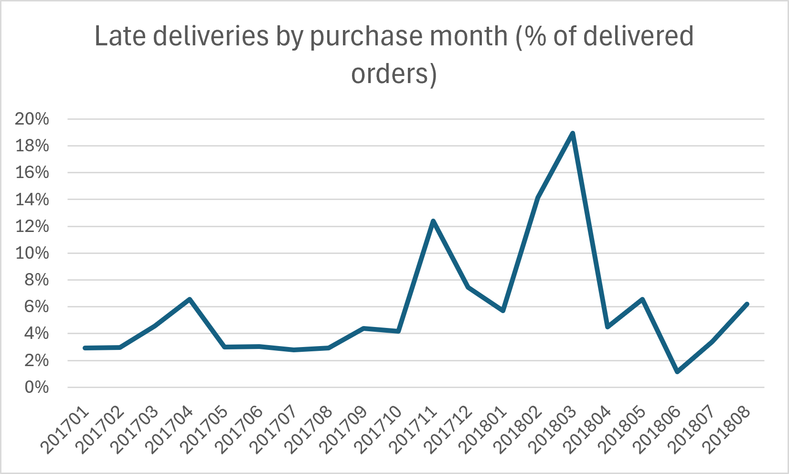

# Delivery Performance Analysis: Why Do Orders Arrive Late?

> **Status:** work in progress. Question 1 is complete. The other questions are being added.

## Business problem

Late deliveries lead to unhappy customers, bad reviews and repeat contacts to support. This project analyses real e-commerce orders to find out **where and why deliveries run late**, and what an operations team could change to reduce it.

Written from an operations and logistics point of view: dispatch, carriers, handover times and service levels.

## Data

[Brazilian E-Commerce Public Dataset by Olist](https://www.kaggle.com/datasets/olistbr/brazilian-ecommerce) (Kaggle): about 99,000 real orders from 2016 to 2018, with purchase, carrier handover and delivery dates, the estimated delivery date, sellers, customer locations and review scores.

The raw files are not stored in this repository. See [`data/README.md`](data/README.md) for how to download them.

## How I defined "late"

An order is **late** when it reached the customer after the estimated delivery date. Orders that were never delivered are excluded. Late rate = late orders ÷ (late + on-time orders).

## Key findings (Question 1: how often are orders late, and when?)

- **6.8% of delivered orders arrived late** (6,535 late out of 96,476 delivered orders).
- Lateness was not steady. It spiked in a few months:
  - **March 2018: 19.0% late**
  - **February 2018: 14.1% late**
  - **November 2017: 12.4% late**



**What this suggests:** the spikes line up with high-demand periods (November is the Black Friday month), which points to carrier and fulfilment capacity problems rather than a constant, everyday problem. The next steps below test this.


## Key findings (Question 4: do late deliveries hurt customer reviews?)

- **Late orders get much lower review scores:** on-time orders average **4.29 out of 5**, late orders average **2.27 out of 5**, a gap of about 2 points.
- Orders that were never delivered (for example cancelled orders) were left out of this comparison.
- Customers who give a review score are matched to their order by `order_id`. Where an order had more than one review, the latest was used. About 770 orders had no review and were excluded.

**What this means:** late delivery is not just a missed date. It roughly halves how customers rate the order, which is the main reason to focus on the spikes in November 2017 and February to March 2018.

## Questions still to answer

2. Which customer states have the worst late-delivery rates? (SQL query already written in `sql/`)
3. Which sellers account for the most late orders?
4. How much does a late delivery lower the customer review score? (done, see Key findings above)
5. Where is the time lost: seller to carrier handover, or carrier to customer?

## Recommendations (draft, to be confirmed by the remaining analysis)

1. Plan extra carrier capacity and earlier cut-off times ahead of peak periods such as November.
2. Add a more realistic delivery estimate for the months and regions that run late, so customers are not promised dates that will be missed.

## Tools

Excel (data cleaning, helper columns, PivotTables, charts). SQL (SQLite) and Python are the next stage.

## How to run the SQL stage

```bash
# 1. Install the requirements
pip install -r requirements.txt

# 2. Put the Olist CSV files in data/raw/ (see data/README.md)

# 3. Load them into a SQLite database
python src/load_data.py

# 4. Run the queries in the sql/ folder against data/olist.db
```

## About me

Noluthando Ngema, based in South Africa. I have worked in remote customer support and in fleet and dispatch operations (managing a 40-vehicle delivery network), and I am building my data analysis skills to move into a remote operations and logistics role.
